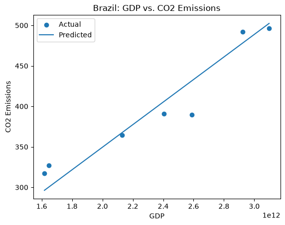
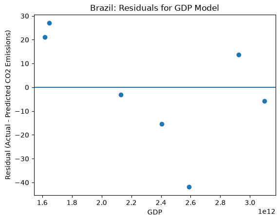

# Brazil GDP and CO2 Emissions

## Project Overview

This project explores whether GDP can be useful for predicting annual
CO2 emissions in Brazil using linear regression.

The original dataset contains observations for multiple countries and
years. For this analysis, I filtered the dataset to Brazil and used GDP
as the feature and CO2 emissions as the target.

## Analytical Question

Can Brazil's GDP be used to predict its annual CO2 emissions?

## Method

The analysis uses a LinearRegression model and compares its performance
with a simple baseline prediction.

After filtering the dataset to Brazil and removing observations with
missing required values, 33 observations were available for modeling.
The data was divided into training and test sets using an 80/20 split.

The model was evaluated using RMSE and R-squared, along with prediction
and residual visualizations.

## Results

The baseline model produced an RMSE of 68.21.

The LinearRegression model produced an RMSE of 22.04 and an R-squared
value of 0.891.

Compared with the baseline, the linear regression model substantially
improved prediction performance. These results suggest that GDP
contained useful information for predicting Brazil's CO2 emissions
within this dataset.

### Regression Predictions

## Interpretation and Limitations

Although the model performed well compared with the baseline, the test
set contained only seven observations. This makes it difficult to
establish a clear residual pattern, and the results should therefore
be interpreted cautiously.

The relationship identified by the model should also not be interpreted
as evidence that changes in GDP cause changes in CO2 emissions.

A useful next step would be to train the model on earlier years and test
it on later years to investigate whether GDP remains useful for
prediction over time.

### Residuals

## Documentation Index

- **Home** - this landing page
- [**Project Instructions**](./project-instructions.md)
- [**Concepts**](./concepts.md)
- [**Palmer Penguins Example Data Card**](./data-card.md)
- [**API**](./api.md)
